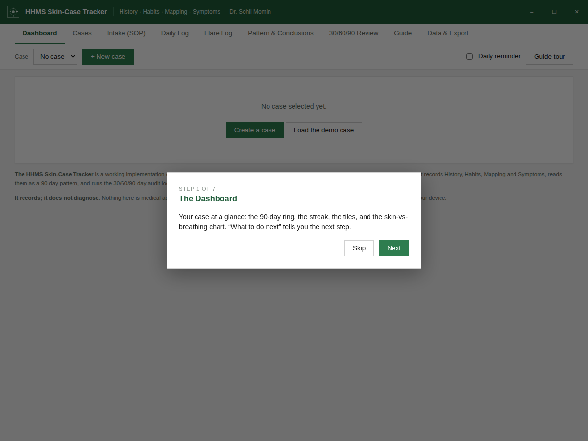
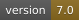
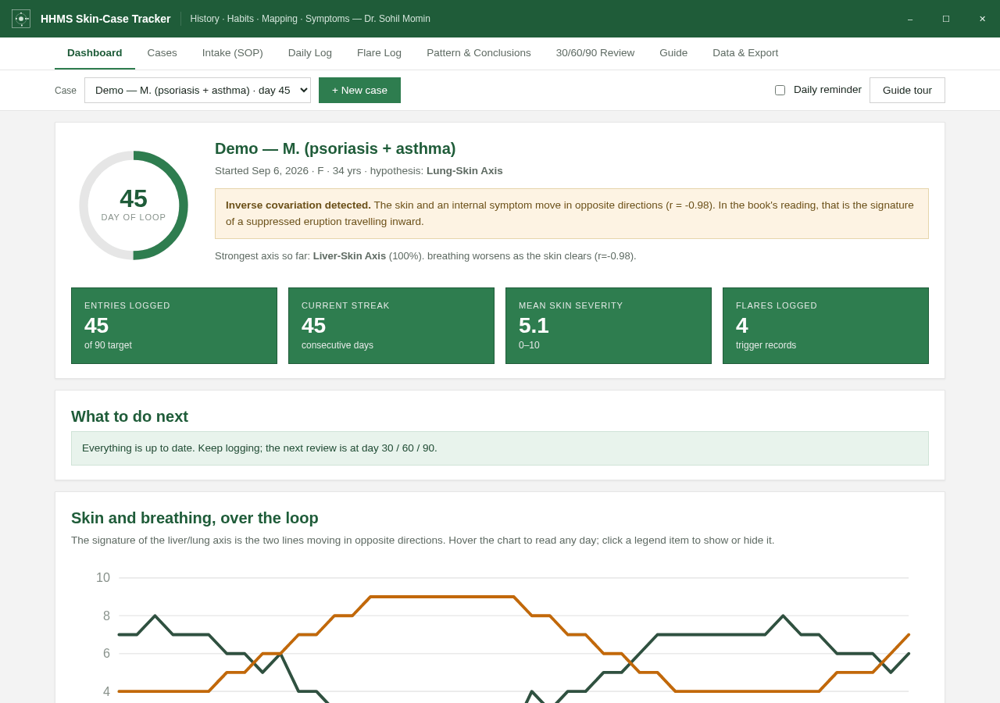

<!-- shot:start -->

<!-- shot:end -->

<h1>HHMS Skin-Case Tracker</h1>

<strong>A private, offline browser app for tracking a skin case over time — History, Habits, Mapping and Symptoms, logged day by day and read as a 90-day pattern.</strong> 
The companion app to the book <em>The Skin Is a Liar</em> by Dr. Sohil Momin. It records; it does not diagnose.

<a href="https://drsamonline.github.io/skin-case-tracker/"><strong>Landing page</strong></a> &nbsp;·&nbsp;
<a href="https://drsamonline.github.io/skin-case-tracker/play/"><strong>Open the live app</strong></a> &nbsp;·&nbsp;<a href="https://github.com/drsamonline/skin-case-tracker/releases/latest/download/skin-case-tracker-portable.exe"><strong>Download for Windows (.exe)</strong></a> &nbsp;·&nbsp; <a href="https://github.com/drsamonline/skin-case-tracker/releases/latest/download/skin-case-tracker.apk"><strong>Download for Android (.apk)</strong></a>
<a href="https://github.com/drsamonline/skin-case-tracker"><strong>Star this repo</strong></a> &nbsp;·&nbsp;<a href="https://drsamonline.github.io/"><strong>All projects</strong></a>

---

<h3>▶ <a href="https://drsamonline.github.io/skin-case-tracker/play/">Open the live app →</a></h3>

No install needed — it runs in the browser and installs as an offline app.

---

## ✨ What it is

A working implementation of the **HHMS dashboard** described in _The Skin Is a Liar_ (chapters 11
and 14). HHMS stands for the four fields it records — **History, Habits, Mapping, Symptoms**. The
book's claim is that the skin is the body's readout, and that a skin case should be tracked over
time and read as a *pattern*, not treated as a snapshot. This is that tracking instrument.

> **It records; it does not diagnose.** Nothing here is medical advice. The reading of the pattern
> is the clinician's job. All data stays on your device.

## 🚀 Quick start

| | |
|---|---|
| 🌐 **Use it now** | Open **https://drsamonline.github.io/skin-case-tracker/play/** |
| 📲 **Install it** | Open the link, then use your browser's **Install** option (⊕ in the address bar, or *Add to Home screen*). It then works fully offline. |
| 🧪 **Try sample data** | Press **Load demo case** on the Cases tab, or open the link with `#demo` on the end. |
| 💾 **Run it locally** | Download the repo and open `index.html` — it is one self-contained file. |

## 🩺 What it does

- **Records** the four HHMS fields — one entry a day (skin severity, the day's habits, and five
  symptom groups), plus a flare log with the 48-hour food, cycle, stress and sleep.
- **Maps** the eruption on a body map (*present · has been · migrated*) and attaches photographs.
- **Connects** the skin against each symptom group, day by day, and scores the **seven organ-skin
  axes** from the book's signatures.
- **Reads** the pattern — a skin-vs-symptoms chart, a lead/lag view, a **colour-blind-safe**
  correlation heat-map, baseline-vs-current, and a plain-language conclusion.
- **Audits** at **30 / 60 / 90 days**, and exports the trail as JSON (the full backup, *including
  photos*), CSV, a pooled research CSV, the photos as a ZIP, or a printable report.

## 🧭 The four fields

| Field | What it captures |
|---|---|
| **History** | The narrative, and the audit of the suppression — eruptions "cured" before an internal complaint, with the latency |
| **Habits** | Stress, cold drinks, alcohol, sleep, heavy food, menstruation, medications, vaccination |
| **Mapping** | Where the eruption is, where it has been, where it has migrated — plus photos |
| **Symptoms** | Cardiac · Respiratory · Digestive · Neurological · Gynaecological, scored 0–10 |

## 🔒 Privacy

Everything is stored in your own browser (`localStorage`). **Nothing is sent anywhere.** There is no
account, no server, and no tracking. Export at any time and import the JSON back on the same or
another device.

## 📦 Exports

| Export | Contains |
|---|---|
| **JSON** (case / all cases) | The complete backup — history, logs, flares, reviews, body map **and photos** |
| **Daily log CSV** | The numeric day-by-day table (image-free) |
| **Pooled research CSV** | One summary row per case, for pooling across cases |
| **Photos ZIP** | The images as files, plus a `manifest.csv` |
| **Photo list CSV** | `case, date, note, filename, bytes` |
| **Codebook (.md)** | The full field dictionary |
| **Print / PDF** | A one-page clinician report |

## ⚠️ Not medical advice

This app records information; it does not diagnose and gives no medical advice. The axis scores are
a transparent, rule-based reading of your own log. If a symptom worries you, see a doctor; in an
emergency, seek emergency care.

## 📜 Licence

**Free to use — for personal and clinical use — but copyrighted.**
Copyright © 2026 Dr. Sohil Momin. **All rights reserved.**

You may use it free of charge for personal and clinical purposes. You may **not** sell it,
redistribute it, publish it, or modify it without written permission. See **[LICENSE](LICENSE)** for
the full terms.

The text of the book _The Skin Is a Liar_ is **not** part of this repository and is not licensed
here.

## 👤 Author

**Dr. Sohil Momin** — Doctor, Poet, Social Worker
[GitHub](https://github.com/drsamonline) · the method is J. Compton Burnett's (1893), modernised in
_The Skin Is a Liar: Stop Treating the Surface_.

<a href="https://drsamonline.github.io/skin-case-tracker/play/"><strong>▶ Open the app</strong></a> &nbsp;·&nbsp;
<a href="https://github.com/drsamonline/skin-case-tracker"><strong>Star this repo</strong></a> &nbsp;·&nbsp;
<a href="https://github.com/drsamonline/skin-case-tracker/issues"><strong>Report an issue</strong></a>

Made with care for clinicians and their patients.

